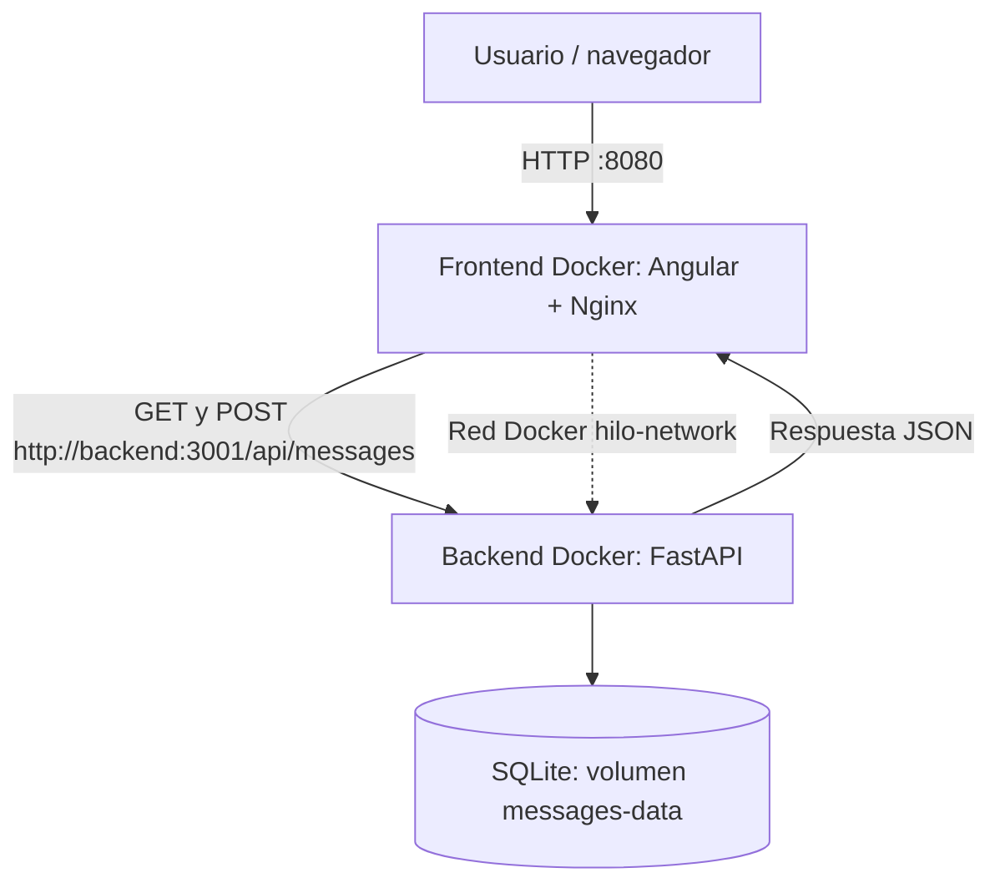

# HILO · Integración Continua · Entrega 1

Proyecto académico de Luis Fernando Soto Marroquin. Conserva la plataforma de
noticias ficticias Angular 21 y agrega mensajes compartidos con FastAPI y SQLite.
Dos contenedores se comunican por una red Docker dedicada.

## Arquitectura

- **frontend:** Node compila Angular; Nginx sirve el resultado en 8080 y reenvía `/api/*` a `http://backend:3001`.
- **backend:** Python, FastAPI y Uvicorn atienden en 3001. SQLite guarda mensajes en `/data/messages.sqlite3`, dentro del volumen `messages-data`.
- La red bridge `hilo-network` conecta ambos servicios; su nombre efectivo habitual es `hilo_hilo-network`.



## Instalación

Requisitos: Docker Engine o Docker Desktop iniciado y Docker Compose v2 o posterior.
Ejecutar desde la raíz del repositorio (`hilo/` en el espacio académico, donde están `package.json` y `docker-compose.yml`):

```bash
cp .env.example .env
docker compose up --build
```

La copia de `.env` es opcional: existen los mismos valores por defecto.
Abrir <http://localhost:8080/#/mensajes>. API directa:
<http://localhost:3001/api/status>; Swagger: <http://localhost:3001/docs>.
Estas direcciones son accesos desde el equipo anfitrión.

Para ejecutar en segundo plano y esperar los healthchecks:

```bash
docker compose up --build -d --wait --wait-timeout 120
docker compose ps
docker compose down
```

`down` conserva los mensajes. `docker compose down --volumes` elimina también los datos: usar solamente para reiniciar la demostración.

## Uso

1. Abrir **Mensajes** desde la navegación.
2. Escribir un texto y pulsar **Guardar mensaje**.
3. La interfaz envía POST y después GET; aparece el mensaje con su identificador.
4. Recargar o abrir otro navegador: el registro se consulta desde el servidor.
5. Recrear los servicios sin eliminar volúmenes: el mensaje continúa disponible.

Inicio, Kiosco, Detalle, Mi Hilo, Redacción y Contacto mantienen sus funciones.
Las noticias y favoritos siguen en localStorage; Contacto conserva su confirmación
simulada. **Mensajes** usa almacenamiento real compartido, sin cuentas: todos los
usuarios de la instancia pueden consultar los registros. GitHub Pages aloja solo
el frontend estático; esta demostración con API debe ejecutarse con Compose.

## Endpoints

| Método | Ruta | Entrada | Respuesta correcta |
| --- | --- | --- | --- |
| GET | `/api/status` | Ninguna | `{"status":"ok"}` |
| GET | `/api/messages` | Ninguna | `[{"id":1,"message":"mensaje de prueba"}]` |
| POST | `/api/messages` | `{"message":"mensaje de prueba"}` | `{"success":true}` |

Todos devuelven HTTP 200 en caso de éxito. Una base nueva devuelve `[]`.
POST acepta entre 1 y 1000 caracteres tras quitar espacios de los extremos;
campos faltantes, adicionales o inválidos producen HTTP 422. FastAPI también
publica `/docs`, `/redoc` y `/openapi.json` en el puerto del backend.

```bash
curl http://localhost:8080/api/status
curl -X POST http://localhost:8080/api/messages \
  -H 'Content-Type: application/json' \
  -d '{"message":"mensaje de prueba"}'
curl http://localhost:8080/api/messages
```

## Comunicación entre contenedores

El navegador llama a `/api` en su mismo origen. Nginx, dentro del contenedor
frontend, consume `http://backend:3001` mediante DNS de Docker. El navegador no
puede resolver por sí mismo `backend`; el proxy permite usarlo en el lugar
correcto y evita necesitar CORS. No se usan direcciones del anfitrión ni IP fijas
como destino de la comunicación entre servicios.

`127.0.0.11` en Nginx es el resolvedor DNS integrado de Docker, no la dirección de
otro contenedor; permite resolver `backend` otra vez si cambia su IP al recrearse.
`0.0.0.0` en Uvicorn es la interfaz de escucha, no un destino.

```bash
docker compose exec frontend wget -qO- http://backend:3001/api/status
python3 tests/integration.py
docker compose down
docker compose up -d --wait
python3 tests/integration.py --verify-persistence
```

El script comprueba Angular, estado, POST y GET por el frontend. La segunda ejecución
comprueba el mismo registro tras recrear los contenedores. Si cambia el puerto:
`FRONTEND_URL=http://localhost:9090 python3 tests/integration.py`.

## Integración continua

`.github/workflows/ci.yml` se ejecuta en cada `push` y `pull_request`:

1. Checkout, instalación con `npm ci`, pruebas y compilación de Angular.
2. Instalación Python, compilación de bytecode y pruebas de API, validación y persistencia.
3. Validación de Compose y construcción independiente de ambas imágenes.
4. Arranque saludable, conexión directa entre contenedores y prueba POST/GET por Nginx.
5. Recreación de servicios y verificación de persistencia; logs y limpieza incluso ante fallos.

Cualquier comprobación fallida hace fallar el pipeline. `pages.yml` conserva el
despliegue estático anterior y es independiente de esta prueba Docker.
Para comprobar la ejecución remota: subir estos archivos, abrir **Actions →
Integración continua · Docker**, seleccionar el commit y verificar todos los pasos
en verde. Un workflow escrito no equivale a una ejecución remota verificada.

## Desarrollo y pruebas locales

```bash
npm ci
npm test
npm run build
python3 -m venv .venv
.venv/bin/python -m pip install -r backend/requirements-dev.txt
cd backend
../.venv/bin/python -m unittest discover -s tests -v
```

`npm start` sirve las vistas originales en 4200; para probar la integración completa
usar Compose. El resultado Angular está en `dist/hilo/browser`.

## Explicación técnica

| Archivo / concepto | Decisión |
| --- | --- |
| `Dockerfile` | Multietapa: imagen oficial Node `22.14.0-alpine3.21`, `npm ci` y build; imagen oficial Nginx `1.28.0-alpine3.21`, puerto 8080 y proceso en primer plano. La imagen final no incluye Node ni dependencias de desarrollo. |
| `backend/Dockerfile` | Imagen oficial Python `3.13.3-slim-bookworm`, dependencias directas con versión fija, usuario sin privilegios y Uvicorn en 3001. Python no requiere un binario; CI compila bytecode y prueba la aplicación. |
| `docker-compose.yml` | Builds locales, puertos, variables, volumen y `depends_on` condicionado a backend saludable. |
| Red Docker | Bridge dedicada y descubrimiento por nombre de servicio. |
| Variables | `.env.example` configura `FRONTEND_PORT` y `BACKEND_PORT`; Compose define `BACKEND_URL` y `DATABASE_PATH` internos. No se necesitan secretos. `.env` se excluye de Git y Docker. |
| Proxy | La imagen oficial Nginx sustituye `${BACKEND_URL}` en su plantilla al iniciar. Se conserva la ruta `/api`. |
| Persistencia | SQLite con consultas parametrizadas y volumen; conexiones cerradas después de usarlas. |
| GitHub Actions | Permisos de lectura, tiempo límite y pruebas funcionales además del build. |
| `.dockerignore` | Excluye dependencias locales, Git, secretos, builds y evidencias; backend tiene un contexto independiente mínimo. |

Referencias: [FastAPI en Docker](https://fastapi.tiangolo.com/deployment/docker/),
[imagen oficial Nginx y plantillas](https://hub.docker.com/_/nginx).

## Evidencias requeridas

Capturar la salida real de cada comando y conservar el commit usado. No presentar
como exitosos pasos que no se hayan ejecutado.

| Evidencia | Comando / captura |
| --- | --- |
| Build frontend | `docker build .` desde esta raíz, mostrando finalización exitosa. |
| Build backend | `docker build -t hilo-backend ./backend` |
| Arranque | `docker compose up --build` y logs; en ejecuciones posteriores, `docker compose up`. |
| Contenedores | `docker ps` y `docker compose ps`, mostrando ambos servicios saludables y puertos. |
| Red | `docker network inspect hilo_hilo-network`; si cambió el nombre del proyecto, localizarlo con `docker network ls`. |
| Conexión interna | `docker compose exec frontend wget -qO- http://backend:3001/api/status` |
| Ida y vuelta | Captura de `#/mensajes` y DevTools → Network con POST y GET exitosos; salida de `python3 tests/integration.py`. |
| Persistencia | Recrear sin borrar volúmenes y ejecutar `python3 tests/integration.py --verify-persistence`. |
| Pipeline | Actions mostrando commit y pasos verdes, incluidos builds e integración. |
